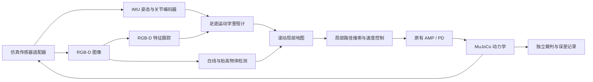

# Pi Plus Pro 相机驱动的自主导航仿真

> 2026-11-11：当前仿真与机载入口已共用 `navigation/`，AMP 固定为真机 Pro 版本。
> 当前代码、测试结果和边界以 [共享导航状态](SHARED_NAVIGATION_STATUS.md) 为准；下文旧策略成绩保留作历史记录。

当前实现位于 `navigation/`：深度平面估计地面，白线和箱面配准、地面纹理匹配提供视觉里程计，
局部网格动态规划与窄箱间隙控制器输出速度，经原厂指令适配交给固定真机 AMP。
仿真和机载使用同一份代码，没有仿真专用的关节/接触里程计兜底；本轮结果以顶部链接为准。

当前模型、实测头姿、相机安装和站姿核对见 [Pro 头部与相机](SIMULATION.md#pro-头部与相机)。以下历史实验使用 Mini 几何和固定相机。

## 历史实现与实验记录

**2026-11-10 运控更新：** 本入口已默认采用真机 Pro 的 AMP 权重、速度滤波/死区与 PD 参数，
物理/PD 频率为 1000 Hz。下文已有整圈结果均来自更新前的 `model_40000.pt`。
当时原导航默认 0.22 m/s 会被真机滤波死区置零，同步当时未重新通过整圈导航；
同步范围和验证证据见 [基础运控同步](SIMULATION.md#2026-11-10真机基础运控同步)。
`--camera-profile legacy` 只选择旧相机参数，不会切回旧运控策略。

这条运行链路用 RGB-D 图像识别跑道和箱体，使用 IMU、关节编码器和 RGB-D 特征跟踪
估计短时运动，再输出身体坐标系速度给原有 AMP loco。导航不读取赛道几何文件、
预设障碍坐标、仿真基座位置、仿真线速度、物体分割 ID 或仿真接触状态。

原有 `scripts/run_sim.py` 仍是独立的真值对照；自主导航入口是 `scripts/run_visual.py`。

原宽视场配置（`--camera-profile legacy`）已从三个起点各完成一圈，包括一次箱体整体移动 10 cm 的测试。
[01 起点原速 50 fps 回放](output/sim/visual_final_v5_01/replay_1x_50fps.mp4)
附实际感知画面；[实际轨迹图](output/sim/visual_final_v5_01/trajectory.png) 用于独立评估。

## 运行

本文历史成绩使用平滑入弯场地，复跑时加 `--bend-profile smooth`。现场折角版和当前 rt1 GUI 的启动方式见 [rt1 机载导航复跑](SIMULATION.md#rt1-机载导航复跑)。

```sh
# 01 起点，默认匹配 D435i 成像参数，相机感知闭环，保存感知视频
.venv/bin/python scripts/run_visual.py --output output/sim/visual_run_01 --video

# 复现原 80° 垂直视场 / 480×360 / 16.7 Hz 配置
.venv/bin/python scripts/run_visual.py --camera-profile legacy --output output/sim/visual_legacy_01 --video

# 正常起点 02；随机种子只控制传感器噪声
.venv/bin/python scripts/run_visual.py --start 02 --seed 2 --output output/sim/visual_run_02 --video

# 03 起点，箱体在仿真世界中整体沿 X 移动 10 cm
# 这个改动不会通知导航模块，导航必须重新看见并定位箱体
.venv/bin/python scripts/run_visual.py --start 03 --seed 3 --obstacle-shift 0.10 --output output/sim/visual_run_03_shifted --video

# 原始动力学状态按 1 倍速、50 fps 渲染，附感知画面
.venv/bin/python scripts/render_visual.py output/sim/visual_run_01

# 从日志独立核验整圈进度、停车，生成实际轨迹图
.venv/bin/python scripts/evaluate_visual.py output/sim/visual_run_01

# 回归检查；原有动力学检查仍适用
.venv/bin/python scripts/test_visual.py
.venv/bin/python scripts/test_camera_profile.py
.venv/bin/python scripts/test_sim.py

# 相机失效：第 5 秒开始 RGB 黑屏、深度无效
.venv/bin/python scripts/run_visual.py --no-obstacles --duration 9 --blind-after 5 --output output/sim/visual_blackout
```

普通运行的 `duration_limit`、碰撞、摔倒或双脚出界返回退出码 2；视觉完赛停车返回 0。
黑屏和限时障碍区测试的预期终态可以是 `duration_limit`，应结合其测试目标检查日志。

## 数据边界



`sim/sensors.py` 将物理仿真状态转换为传感器包。导航能得到的字段只有图像、深度、
时间戳、IMU 姿态/角速度、关节角。足底运动学使用单独的机器人模型进行 FK，
根平移始终置零；通过最低足底点估计支撑足，不读取物理引擎的真实接触标签。

IMU 姿态是一个模拟 AHRS 输出，尚未实现由原始加速度、角速度和磁场组成的完整姿态滤波器。
这属于明确声明的虚拟传感器假设。它不是世界位置或完整位姿定位接口。

`sim/visual_navigation.py` 只接受上述测量及估计里程计，不导入 MuJoCo 或场地文件。
`scripts/run_visual.py` 负责创建世界、调用导航、独立判罚和记录。日志中的 `truth_*`
与 `eval_progress` 只用于评估，未传回控制器。渲染器使用真实姿态展示实际运动。

## 感知、规划与终点

- RGB 中的亮度/饱和度用于提取白线；RGB-D 地面点与 IMU 姿态用于恢复米制地面坐标。
  结合已知 50 cm 跑道宽度拟合两侧边界，单侧被遮挡时从可见边界推断中心线。
  排除脚前 30 cm 内的白色机器人部件，并用已检测的箱体范围过滤箱底高光，减少假白线。
- 深度中的抬高点云经过聚类检测箱体，不依赖箱体颜色或物体 ID。20 cm 箱体尺寸是规则先验。
  箱顶完整可见时拟合顶面矩形；不完整视野中的箱体不能直接用“可见表面的中心”替代实体中心，
  从竖直表面拟合可见面的法向，再向箱体内部偏移半个箱宽恢复中心。只看到单个面时，
  沿法向更新位置，沿面方向保留跟踪结果并用可见点范围约束；看到两个相邻面时恢复两个方向。
  已跟踪箱体的可见面残差还用于修正整组静止障碍的共同位置漂移，使被遮挡箱体与可见箱体
  使用一致的运动补偿。木箱缝隙中露出的内侧板归入已有箱体，不生成重复目标，也不使用未知
  板厚的内侧面去修正外轮廓中心。该处理不使用箱体间距、地图坐标或真值位姿。
- 已看见的白线形成附近局部地图；优先拟合最近 2.5 秒的白线，当前证据不足时才使用较早观测，
  防止累计里程计误差把直道拟合成弯道。遮挡的箱体保留到估计身体通过之后，不因短时看不见而删除。
- 通过光流跟踪 RGB 特征，结合两帧深度与 IMU 旋转估计平移。匹配不足时退回足底运动学里程计。
  可靠的视觉平移不再与有滑移偏差的足端估计混合。不将下发速度直接积分成定位结果。
- 避障与巡线完全分离：检测到车道一侧 1.0 m 内、横向偏离车道中心 0.40 m 内的箱体后进入避障模式，
  巡线策略不再参与。先停止前进，向箱体另一侧横移，直到那侧的边界线移到机身正下方。
  居中判据是"机身到边界线的垂直距离"：距离进入 5 cm 容差、或在 9 cm 内符号翻转、
  或横移超过 55 cm，三者任一满足即结束横移，保证总会终止；机身 yaw 倾斜只会让线在画面里
  变斜，不会让这个垂距永远到不了零。
- 居中后沿这一根白线前进，允许前进、横移和转向。横向以垂距闭环伺服，并刻意骑在线外侧 4 cm：
  白色箱面会把边界拟合往车道内拉偏，而箱体一侧正是车道内侧。骑线途中遇到挡线的箱体
  （前方 0.45 m 内、距线 0.32 m 内）则重复避障操作；重触发的横移带 0.10 m/s 前向斜移，
  因为 0.5 m 箱间距下刚越过的箱体就贴在身后，纯横移会落在它上面。
- 连续 3 帧前方无箱体、视野中双边界线可见、且本次避障记录的箱体都在身后 0.5 m 以外，
  才退出避障模式回到巡线。仅凭"前方无箱"会在箱体贴身时提前退出，
  回中车道的横向牵引会扫到尾侧手臂。
- 横移期间用估计里程计闭环保持纵向位置，并补偿基础 loco 纯侧移时的约 0.02 m/s 前向漂移。
  仅发送 `vx=0` 不能保证身体没有前移。
- 本次选定的出发位置增加了 **3 cm 宽的白色横向终点线**，其坐标只用于生成场景贴图。
  导航须从画面发现横向白线，且 IMU 累计转角超过 5.5 rad 才允许触发终点；
  最后近距离盲区由短时里程计追踪最近一次看见的终点线。线宽和外观是仿真假设，尚非实测赛场规格。
- 图像/深度失效、跑道无法估计或测量超时都会使速度指令按变化率限制降至零。
  横移 4 秒内找不到可用远侧边界线、或停滞恢复两次后仍无法前进，会以 `navigation_blocked`
  结束并保存诊断数据，不绕过障碍判定继续走。

## 传感器与时序假设

当前默认 `--camera-profile d435i` 使用 [实机成像配置](sim/d435i_camera.json)：
2026-11-10 实机读取的彩色工厂内参 `fx=604.179, fy=603.821, cx=325.629, cy=245.226`，
640 × 480 采集，RGB 面积插值、深度最近邻降采样到 320 × 240，与实机 shadow 程序一致。
MuJoCo 渲染同时配置焦距和主点偏移；实际垂直/水平视场约 43.35° / 55.81°。
标称采样 15 Hz，采样截止时间向后取到最近的 50 Hz 控制时刻，因此帧间隔为 60/80 ms、平均 15 Hz；
`observations.json` 保存实际时刻，回放按这些时刻同步感知画面。物理仍为 500 Hz。

机身安装位置仍为 `(0.09, 0, 0.22) m`，俯视仍为 45°，有效深度范围仍为 0.15–4 m。
此次仅对齐成像参数，未将实机可动头部或未完成标定的机身外参加入仿真。
用户随后提供的 [Pi Plus Pro URDF](reference/pi_plus_pro_261010/urdf/PiPlusPro_SF_12L8A0G2H0W_Z_261010.urdf)
及网格已保存到 `reference/pi_plus_pro_261010/`，来源哈希与头部链见
[camera_chain.json](reference/pi_plus_pro_261010/camera_chain.json)。模型包含头部 yaw/pitch 和固定相机接头，
头关节零位时 `camera_link` 相对 `base_link` 为 `(0.047642, 0.031234, 0.297392) m`；
URDF 未定义独立光学坐标系，机械参考系到镜头光心仍需核对。这份模型未替换本轮的机器人或相机外参。
`--camera-profile legacy` 保留原 480 × 360、垂直视场 80°、每 0.06 秒一帧的配置；
原真值基线相机仍为 70° / 30°。导航使用静态内参和机身固定外参，不读取相机的仿真世界位姿。
默认向导航测量加入 IMU 旋转噪声 0.0008 rad、编码器噪声 0.0001 rad、
深度噪声 0.7 mm，均为独立高斯标准差。`--no-noise` 仅用于诊断。
这些噪声施加在导航传感器适配器；底层 AMP 保持原基线的理想关节/惯性测量，未额外注入噪声。

这些噪声不代表真实硬件标定。感知目前与物理仿真同步执行，未模拟处理时延、滚动快门、
运动模糊或复杂深度缺失。macOS OpenGL 会提示深度精度受限；平地投影探针已检查，
仍不能以此替代真实相机标定和误差测试。当前没有全局 SLAM、MPPI、ROS2 或实机部署。

仍允许单脚部分越线，并沿用“双脚均离开跑道”的工程判罚。落脚滑移、碰撞包络的泛化、
光照/地面材质/摩擦变化、不同箱体摆法和实机可靠性均需要继续验收。

## 输出

每次运行保存 `scene.xml`、带视觉终点线的 `camera_carpet.png`、`states.npz`、
`telemetry.csv`、`observations.json`、`summary.json`、`camera_settings.json` 和定期/末帧感知截图。
`run_manifest.json` 与 `source/` 自动保存本次参数、相机配置、代码哈希和源文件快照。
`--video` 增加 `perception.mp4`；回放脚本增加 `replay_1x_50fps.mp4`。
独立评估脚本增加 `evaluation.json` 和 `trajectory.png`，使用的地图与真值不会回传导航。

感知视频中洋红色表示白线候选，橙色表示抬高点候选；它们都是算法由 RGB-D 计算得到的，
不是仿真器输出的语义标签。`observations.json` 记录实际估计的跑道、障碍、终点及视觉里程计匹配数。

## 验证记录

### 2026-11-11：侧移换道避障策略（与巡线完全分离）

避障策略整体替换为 `navigation/avoid_controller.py` 的侧移换道：检测到箱体制动并横移到
对侧边界线正下方，然后沿这根单线前进，循环处理后续箱体，最后回到巡线。
巡线策略代码零改动；感知、里程计、终点与恢复逻辑不变。回归 `scripts/test_avoid_controller`
18 项全部通过，原有 10 个导航测试套件全部通过（`test_line_supervisor` 为 opencv 4.10 轮子
缺 `cv2.gapi.wip.draw.Text` 的环境性失败，与本次改动无关，未修改代码上同样失败）。

本机 AMP 步态滚动无法复现起步前进（与 SHARED_NAVIGATION_STATUS.md 记录的作者自测回归一致），
端到端步行验证在这台机器上对任何代码版本都不可用，因此新增
[scripts/run_visual_kinematic.py](scripts/run_visual_kinematic.py)：真实渲染、真实感知与
全部运行时门控，仅身体以理想速度跟踪导航指令，验证策略本身而非步行动力学。
01 起点正对箱体直道，`--one-sided-boxes` 把三箱全部挪到同一侧（贴合内线），符合
"箱体一定在车道一侧"的赛制前提：

```bash
OPENBLAS_NUM_THREADS=1 .venv-shared/bin/python scripts/run_visual_kinematic.py \
  --start 01 --spawn 2.55 1.25 3.14159 --one-sided-boxes --debug-avoid \
  --duration 40 --output output/kinematic_onesided
```

结果：0.9 m 处触发一次横移（3.4 s 到达远侧线），骑线通过全部三个箱体，
最小体心-箱面距离 **0.296 m**（躯干包络余量 +8.6 cm，手臂 .247 m 余量 +4.9 cm），
箱体全部在身后 0.5 m 外后经 3 帧双线确认退回巡线，随后正常巡线至弯道。

当前 scene_config.json 的箱体实际为内外交替（0.5 m 间距）。几何上这台机器的手臂包络
（±0.247 m）加 0.2 m 箱宽共 0.494 m，与 0.5 m 间距下的任何换道路径相当：连最优的
车道中线穿行也只有约 0 手臂余量。运动学验证中交替布局循环推进（三箱三次横移、正常退出），
但重触发斜移存在最大 −3.8 cm 的体心角部侵入——与作者实测"左腕碰 02 号箱"一致，
属于身体几何限制而非策略缺陷；一侧布局（赛制前提）下无此问题。

### 2026-11-10：窄视场下的箱体中心与遮挡跟踪修复

最终运行 [d435i_spacing_fix_20261110/run_03](output/sim/d435i_spacing_fix_20261110/run_03/)
在 **128.18 s** 视觉识别终点，继续观察 3 s 后以 `completed` 结束。
独立核验累计赛道进度 22.163 m / 21.563 m（102.78%），`full_lap_verified=true`；
没有碰撞、摔倒或双脚出界判罚。减速阶段位移 9.63 cm，最后一秒位移 0.522 mm、速度指令全为零。

相机配置与上一轮失败运行逐项一致：D435i 工厂内参、640×480 采集后降采样到 320×240、
平均 15 Hz、原安装位置和 45° 俯角。01 起点、随机种子 1、三箱布局、速度上限 0.22 m/s、
噪声和判罚均保持不变。底层机器人、RGB-D 里程计、规划器及碰撞余量没有修改。

修复覆盖三个相关问题：只看见正面时用面法向和半箱宽恢复中心；借助可见静止表面统一修正
隐藏与可见箱体的跟踪漂移；将透过木板缝隙看到的内侧面关联回同一箱体。
中间两轮分别在 95.98 s 规划阻塞、96.756 s 左腕接触第三箱，源文件快照和记录均保留；
最终版本通过完整一圈。运行中间距来自测量，没有把实际 50 cm 间距写入感知或规划。

15 项检查通过（原 9 项视觉回归、6 项相机/箱体感知回归），包括不同真实间距 50/57/44 cm、
部分可见及旋转面、累计 4 cm 里程计偏差和木箱内侧板重复识别。44 cm 的不可通行间隙仍被拒绝。
结果限于本次 01 起点/种子 1 的完整运行，尚未重做其余起点和随机种子验收。

证据：[对比数据](output/sim/d435i_spacing_fix_20261110/comparison.json)、
[检查记录](output/sim/d435i_spacing_fix_20261110/repair_validation.json)、
[独立评估](output/sim/d435i_spacing_fix_20261110/run_03/evaluation.json)、
[原速回放](output/sim/d435i_spacing_fix_20261110/run_03/replay_1x_50fps.mp4)。

### 2026-11-10：匹配实机成像参数的一轮测试

运行 [d435i_matched_01_20261110](output/sim/d435i_matched_01_20261110/)：01 起点、随机种子 1、
原三个箱体、速度上限 0.22 m/s、传感器噪声开启、限时 180 s。仅调整相机成像参数，
`sim/visual_navigation.py` 和 `sim/robot.py` 与本次修改前的文件哈希一致；安装位置和 45° 俯角未变。

**结果：未完赛，`navigation_blocked`。** 74.88 s 开始避障，81.80 s 进入持续规划阻塞，
91.84 s 达到连续阻塞 10 s 的退出条件。独立评估进度为 15.145 m / 21.563 m（70.24%）。
没有触发碰撞、摔倒或双脚出界判罚；最后一秒速度指令均为零，位移约 0.018 mm。
1378 帧的平均采样频率为 15.000 Hz，实际帧间隔为 60/80 ms。

离线重放全部感知与里程计输入，逐帧复现了原运行速度指令（最大误差 0）。
首次阻塞时，相邻两个箱体沿前进方向的中心间距估计仅 0.4403 m，而场景实际为 0.50 m。
当前规划器计入箱宽 0.20 m、身体长度 0.26 m 及前后余量后需要至少 0.47 m，
因此估计的膨胀障碍重叠约 2.97 cm。只在离线诊断中把第二箱的纵向间距改为 0.50 m，
其余输入不动，规划立即存在可行路径。这定位了本次阻塞的直接原因为障碍间距估计偏小；
窄视场、分辨率和帧率对估计误差各自的贡献尚未分开测试。首次阻塞帧的视觉里程计有效匹配数为零。

证据：[summary.json](output/sim/d435i_matched_01_20261110/summary.json)、
[evaluation.json](output/sim/d435i_matched_01_20261110/evaluation.json)、
[diagnosis.json](output/sim/d435i_matched_01_20261110/diagnosis.json)、
[轨迹](output/sim/d435i_matched_01_20261110/trajectory.png)、
[原速回放](output/sim/d435i_matched_01_20261110/replay_1x_50fps.mp4)。
原有 9 项视觉回归检查、2 项实机内参渲染/地面投影检查通过。

### 原宽视场配置的历史结果

以下三次历史运行使用相同的最终控制代码及原宽视场相机，均开启传感器噪声。每种配置各跑一轮，
全部绕过三个箱体、视觉识别终点，并继续仿真 3 秒检查停车。

| 起点 / 随机种子 | 箱体沿世界 X 平移 | 视觉完赛用时 | 停车减速期间位移 | 最后一秒位移 | 判罚 |
|---|---:|---:|---:|---:|---|
| 01 / 1 | 0 cm | 132.08 s | 9.10 cm | 0.42 mm | 无 |
| 02 / 2 | 0 cm | 129.36 s | 9.31 cm | 0.38 mm | 无 |
| 03 / 3 | +10 cm | 129.68 s | 10.14 cm | 0.52 mm | 无 |

记录目录分别为 `output/sim/visual_final_v5_01/`、`visual_final_v5_02/`、
`visual_final_v5_03_shifted/`。`summary.json` 是运行结果，`evaluation.json` 独立核验了
真实累计赛道进度超过一圈、结束前 1 秒指令为零；`run_manifest.json` 与 `source/` 保存参数、
代码哈希与运行源文件快照。模型车道中心长度为 21.5635 m；与规则内圈 19 m 的区别见 README。

接触在物理 500 Hz 内检查，双脚与跑道的投影重叠在 50 Hz 检查。
这些通过结果允许部分脚掌越线，不代表双脚始终完整在线内。当前结论限于上述受控仿真配置，
尚未进行大量随机种子、弯道障碍、光照/摩擦变化或实机可靠性测试。

8 项视觉/导航回归检查及原有 5 项动力学/判罚检查通过，覆盖输入边界、图像产生横向误差、
相机失效停车、遮挡箱体保留、新白线优先、终点防误触发、窄缝采样和遮挡时方向保持。

相机黑屏实测见 `output/sim/visual_final_blackout/blackout_evaluation.json`：
5.00 s 开始 RGB 黑屏且深度无效，导航进入 `lost_vision` 并减速停车。
5.60 s 指令归零，8–9 s 实际位移约 0.16 mm。
失去视觉时没有自动退回真值导航。该测试主动限时 9 s，`duration_limit` 是预期终态。

参考：[MuJoCo 传感器与模型说明](https://mujoco.readthedocs.io/en/3.17.0/XMLreference.html)、
[OpenCV 光流接口](https://docs.opencv.org/4.x/dc/d6b/group__video__track.html)。
